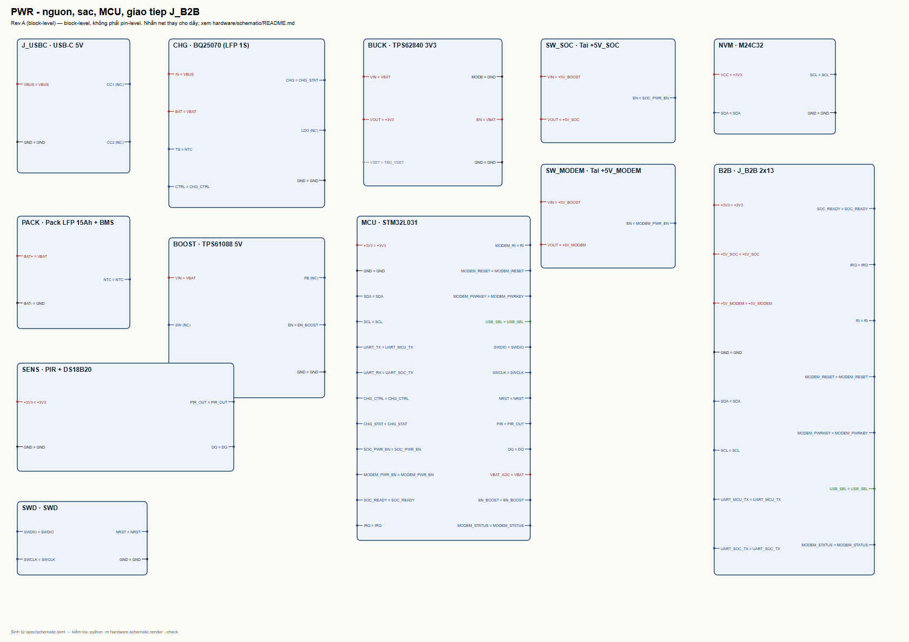
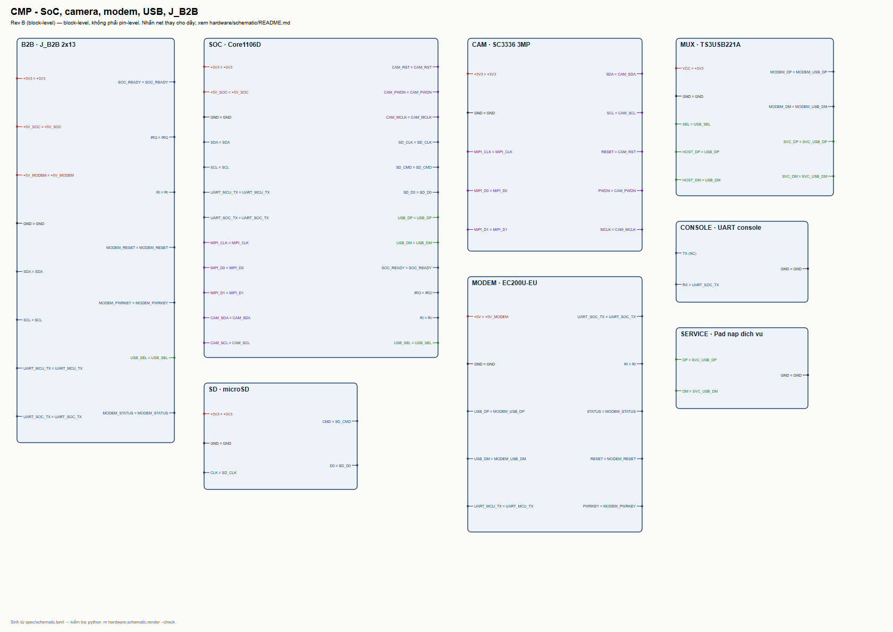

# Schematic khối PWR/CMP

Đây là schematic **mức khối** (block-level), sinh tự động từ [spec/schematic.toml](../../spec/schematic.toml). Mỗi khối là một chức năng; các net nối bằng nhãn tên, không vẽ dây dài. Mục đích: chốt power tree, giao diện giữa các khối và net giữa PWR với CMP trước khi vẽ pin-level.

| File | Nội dung |
|---|---|




| [pwr-blocks.svg](pwr-blocks.svg) | PWR: USB-C, BQ25070, pack, boost, buck, MCU, tải, EEPROM, cảm biến, SWD, J_B2B |
| [cmp-blocks.svg](cmp-blocks.svg) | CMP: J_B2B, Core1106D, camera, modem, microSD, mux USB, console, pad dịch vụ |

## Vì sao chưa phải pin-level

Chưa có đủ dữ liệu để gán số chân đúng:

1. **VSET buck** (TPS62840): chưa chốt giá trị R13 và bảng VSET.
2. **Camera**: chưa chốt thứ tự 20 chân FPC của SC3336.
3. **Modem**: chưa xác nhận breakout đưa RI ra header.
4. **Pack/BMS**: chưa có đầu nối và NTC thực tế.

Vẽ pin-level lúc này sẽ phải bịa chân — đúng lỗi đã xảy ra với BQ25070 ở các vòng trước. Khi bốn dữ liệu trên có, bước tiếp theo là thay block bằng symbol thật trong KiCad và chạy ERC.

## Kiểm tra

```bash
python -m hardware.schematic.render          # in lỗi/cảnh báo
python -m hardware.schematic.render --write  # ghi SVG
python -m hardware.schematic.render --check  # CI: spec và SVG phải khớp
python hardware/schematic/tests/test_schematic.py
```

Quy tắc net:

- Mỗi net phải có ít nhất hai đầu, trừ net `TBD_*` (cảnh báo).
- Pin không nối ghi `(NC)`.
- UART tách theo hướng: `UART_MCU_TX` (MCU→SoC), `UART_SOC_TX` (SoC→MCU/console), `MODEM_UART_TX/RX` (modem).
- USB tách host/modem/dịch vụ qua mux, không nối chung.
